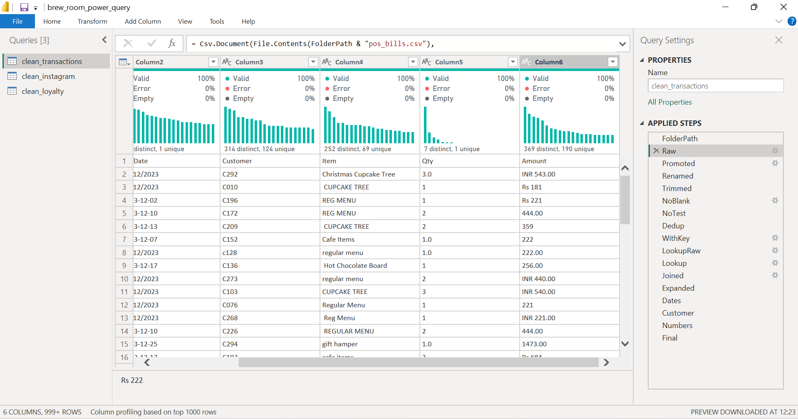
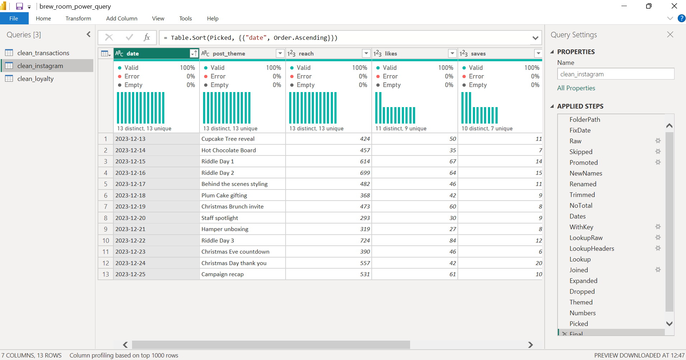
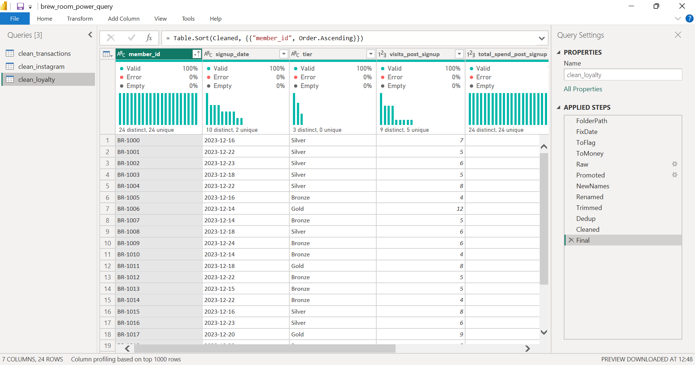
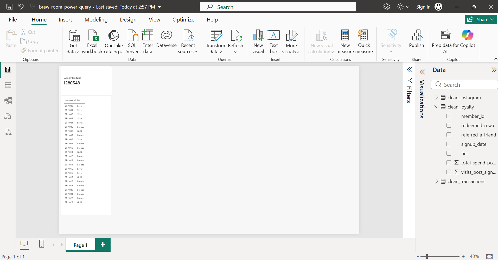

# Power Query cleaning (Power BI Desktop)

The same cleaning as `../alteryx/reference_cleaner.py`, done in Power Query. Three scripts take the messy exports in `../alteryx/raw/` and produce the clean tables.

> **Status:** all three scripts have been run in Power BI Desktop and pass the checks below (2,421 transactions, total ₹12,80,548, 13 Instagram rows, 24 loyalty members, tiers Bronze/Silver/Gold).

| Script | Input | Output |
|---|---|---|
| `clean_bills.pq` | `pos_bills.csv`, `product_lookup.csv` | clean transactions |
| `clean_instagram.pq` | `instagram_export.csv`, `post_theme_lookup.csv` | clean Instagram engagement |
| `clean_loyalty.pq` | `loyalty_signups.csv` | clean loyalty members |

## How to run one
1. Open Power BI Desktop. Home → **Get data → Blank query**.
2. Home → **Advanced Editor**. Delete the contents and paste a whole `.pq` file.
3. Change `FolderPath` at the top to the folder where your CSV files are (keep the final `\`).
4. Click **Done**. Rename the query (right panel) to `clean_transactions`, `clean_instagram` or `clean_loyalty`.
5. Repeat for the other two scripts.

## Checks the output must pass
| Check | Expected |
|---|---|
| Rows in clean transactions | 2,421 |
| Sum of `amount` (all dates) | 12,80,548 |
| Revenue 13 to 25 Dec | 10,29,785 |
| Gifting Hampers revenue in that window | 4,99,998 |
| Clean Instagram rows | 13 |
| Loyalty members | 24 |
| `tier` values | Bronze, Silver, Gold only |

To check totals: close the editor (Home → **Close & Apply**), add a Card visual, drag `amount` into it.

## Screenshots

| What | Image |
|---|---|
| Raw POS export before cleaning (padded text, mixed dates, `Rs`/`INR` amounts) |  |
| `clean_instagram`: 13 rows after removing junk lines and the Total row |  |
| `clean_loyalty`: 24 members, tiers fixed, flags as true/false |  |
| Power BI report: card shows 1280548, matching the answer key |  |

## What the cleaning does
- Removes junk lines, blank rows, test bills and the Total row; drops duplicate bills.
- Trims text and fixes casing; maps item and post names to clean names with lookup tables.
- Converts two date formats to one; strips `Rs` and `INR` from amounts.
- Turns Y/Yes/TRUE style flags into true/false.
