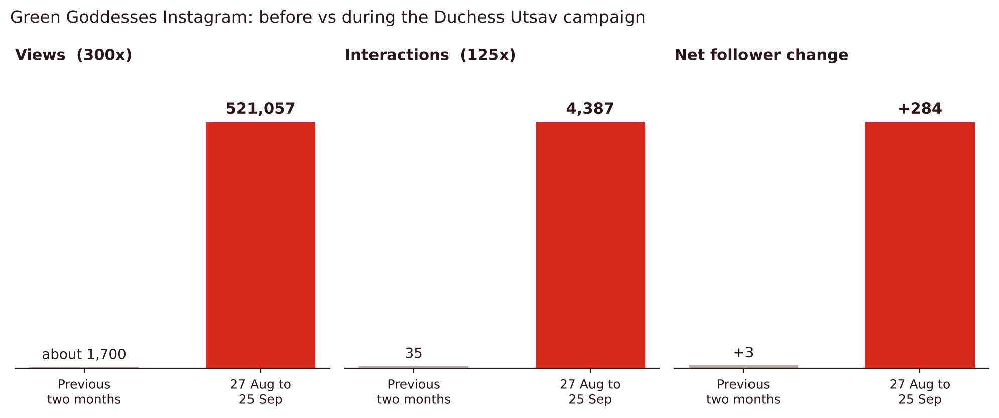
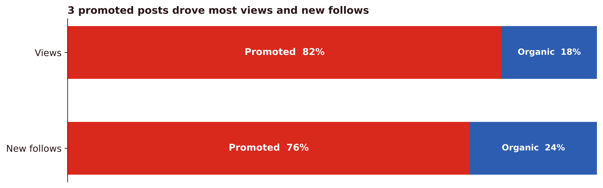
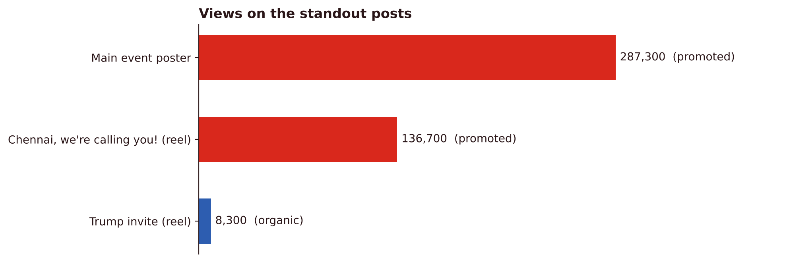
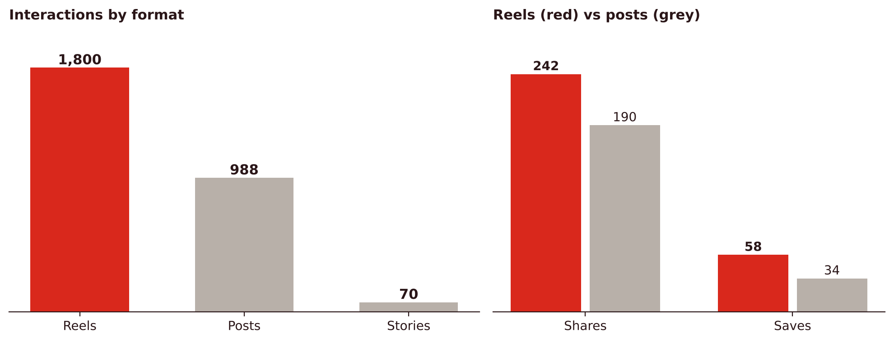

# Green Goddesses at the Duchess Utsav: Instagram campaign analysis

A marketing analytics case study on a real Instagram campaign: before and after, paid versus organic attribution, format performance and audience analysis.

**Client:** Green Goddesses ([@greengoddessess](https://www.instagram.com/greengoddessess/)), a Chennai women's sustainability collective.
**Event:** Duchess Utsav, a two-day exhibition and fashion show at Hotel Savera, Chennai, 25 to 26 Sept 2026.
**My role:** Social Media Marketing Manager (contract). I took over the page on 2 Sept 2026.
**Brief:** build awareness, followers and footfall for the event in under a month.

The Duchess Utsav fashion show was produced by Green Goddesses. My work was its content and promotion.

## About the data

These are **real figures**, read from Instagram Insights for the client's account, for 27 Aug to 25 Sep 2026. The window starts a few days before I took over the page on 2 Sept. The CSV files in [`data/`](data/) are the figures typed in from Insights, not raw exports (the raw exports belong to the client's account). "Previous two months" is the comparison period used in the Insights report, and its views figure is approximate (about 1,700).

Instagram cannot measure walk-ins. Stall owners reported Instagram-driven visitors, but I do not have a footfall number, so this analysis does not claim one.

## What I did

- Social media strategy and a 58-piece, 4-phase content calendar: stall spotlights, final push, live event coverage, post-event recap.
- Paid promotion: proposed and managed 3 promoted posts targeting women 35+ in Chennai.
- Content creation: reels, carousels, posters, and an introduction post or reel for every vendor stall.
- Directed and produced a multi-location designer-wear shoot for Reels.
- Collab reels with jewellery partner FEDHA.
- Analysed Instagram Insights and wrote a results report and growth plan for the client.

## Results (27 Aug to 25 Sep 2026)

| Measure | Result |
|---|---|
| Views | 521,057 (5.2 lakh), up from about 1,700 in the previous two months (300x) |
| Share of views from non-followers | 95% |
| Reach | 263,001 unique accounts |
| Profile visits | 7,178 |
| Interactions | 4,387, up from 35 in the previous two months (125x) |
| Followers | +284 net, to 1,504 (up 23%), against +3 in the previous two months |
| Week of 14 to 20 Sept | Views up 201% on the week before |

Google's AI Overview for "green goddess chennai" now cites the Instagram page and names the event.

## Paid versus organic

Three promoted posts drove **82% of views** and **76% of new follows**.

- **"Chennai, we're calling you!" reel (promoted):** 136,700 views, 102,100 reached, 147 follows, 1,300 likes, 74 shares, 47 saves. The top performer.
- **Main event poster (promoted):** 287,300 views, 147,800 reached, 83 follows.
- **Organic:** stall introductions and event-day reels got the most comments and shares with no ad spend. The best organic reel, "Trump invite", had 8,300 views, 150 likes, 24 comments and 29 shares.
- **FEDHA collab reels:** 11,900 views (silver collection) and 5,700 views (fashion show).

## Which formats worked

Reels got 1,800 interactions, against 988 for posts and 70 for stories. Reels also got 242 shares and 58 saves, against 190 and 34 for posts.

## Audience

78% women. Ages 35 to 44 are the largest group (29%), and 77% of followers are 35+. 66% are in Chennai, and the audience is most active between 6 and 9 pm. This confirmed the targeting worked.

## What I learned

- Paid ads brought in new audiences; organic content built engagement.
- Collabs with partner brands multiply reach for a small page.
- Instagram cannot measure walk-ins, so footfall needs a different method (for example, asking visitors how they heard about the event).

## The plan I wrote for the client

Target: 2,000 followers by 31 Dec 2026 (+500, up 33%). 3 to 4 reels and 3 posts a week at 6 to 9 pm, a Green Club membership drive, brand collabs, small targeted ads for key moments, and monthly reporting.

## Files

| Path | What it is |
|---|---|
| `data/before_after.csv` | Previous two months vs 27 Aug to 25 Sep: views, interactions, net followers |
| `data/paid_vs_organic.csv` | Share of views and new follows from the 3 promoted posts |
| `data/top_posts.csv` | The standout promoted and organic posts |
| `data/formats.csv` | Interactions, shares and saves by format |
| `data/audience.csv` | Audience shares |
| `make_charts.py` | Draws the four charts in `charts/` from the CSV files (`python make_charts.py`) |
